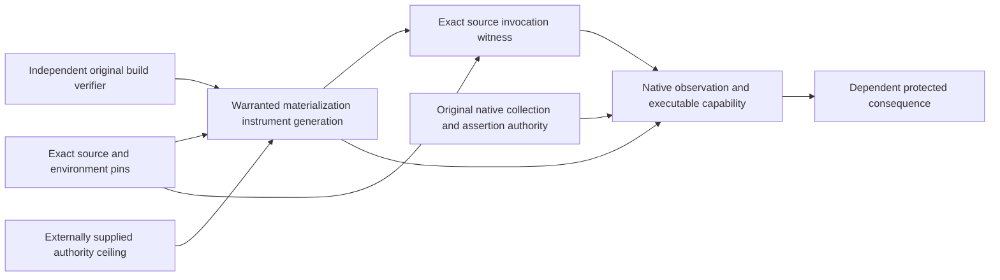

The installed interface preserves the existing Metatron/FLASH state authority. This is the dependency shape checked by the native interface qualification, not a new registry or a fresh prospective result.

Withdrawing the exact invocation or its instrument invalidates dependent routes before their next governed execution. Independent routes survive. Fresh restoration creates new evidence lineage; it does not reactivate old revoked descendants. The same-filesystem native restart is qualified on retained interface fixtures. The later six-source frontier used zero V43 generated-build launches and yields no new developmental causal claim.
