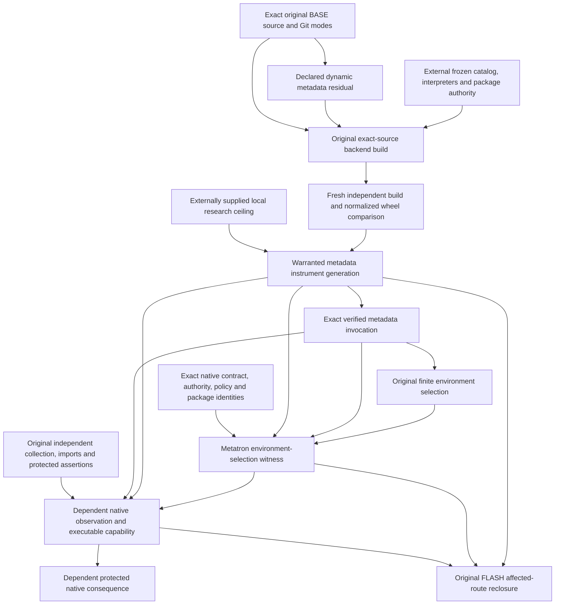

This documentary graph describes the installed V44 dependency interface, independently qualified for bounded native admission at source `e596d6af124b819197d17d447b247a9007fbbf42`, [run 39704649682](https://github.com/heathsanchez/test/actions/runs/39704649682), artifact 12395561842. Its 4,198-check independent audit covers original metadata builds, actual native assertions, causal cuts, restoration and separate-process restart on frozen infrastructure fixtures. The graph is not a new registry, formal refinement proof or prospective G2 certificate.

The metadata identity has nine fields and the independently checked native identity eleven; neither digest is substituted for the other. The environment witness binds their lawful use under the same independently fixed profile, exact source/protocol and native contract. The native verifier remains the authority for protected outcomes.

Withdrawing an exact invocation, environment-selection witness or instrument ancestor must invalidate only its dependency cone before further governed native execution. Unrelated support survives. Restoration creates fresh support, evidence and generation; old revoked descendants remain inactive. The cold-restart path executes a fresh original backend build, independent metadata verification and protected native execution on the same filesystem.

The new operation supplies an experiment prerequisite. It acquires no external permission, dependency, constructor grammar or learning policy. A setup or native refusal outside the narrow metadata scope remains UNKNOWN. The later fresh frontier admitted zero of two tasks and never released a learner or comparator. No prospective G2 decision, G3 expansion or G4 comparison follows.

The readiness inventory API correction exports the original static catalog checker without adding a causal capability or altering the graph. Its two pre-task RED controls, two GREEN controls and actual two-profile runtime inventory remain engineering lineage. It grants no task admission or scientific verdict.

Both fresh tasks reached compatible static environment selection and then stopped in the unchanged suite-contract grammar, before metadata/backend or native test execution. This preserves a separate observation about the next interface obstruction; it does not revoke the qualified metadata instrument or establish protected native failure on those tasks.
